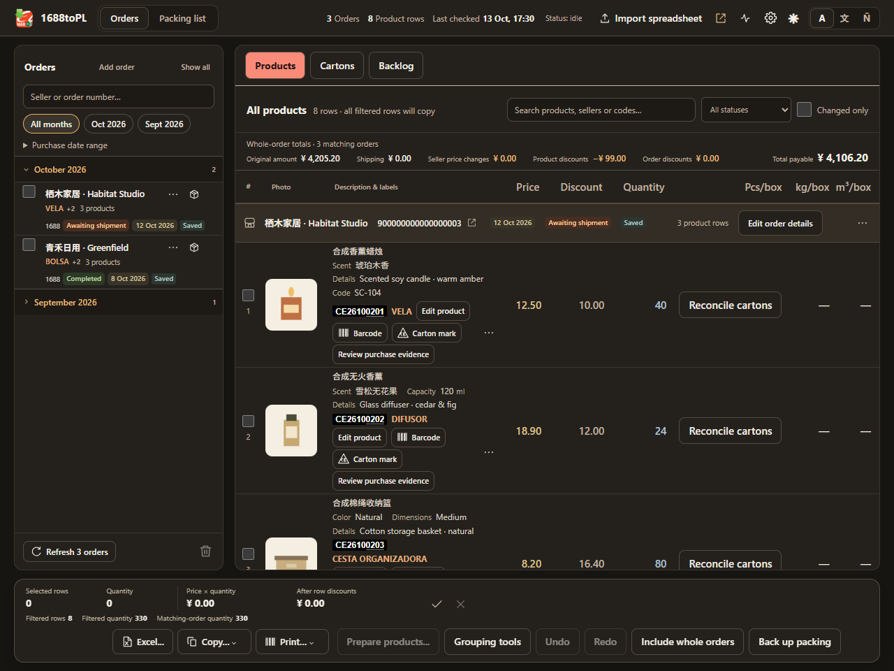
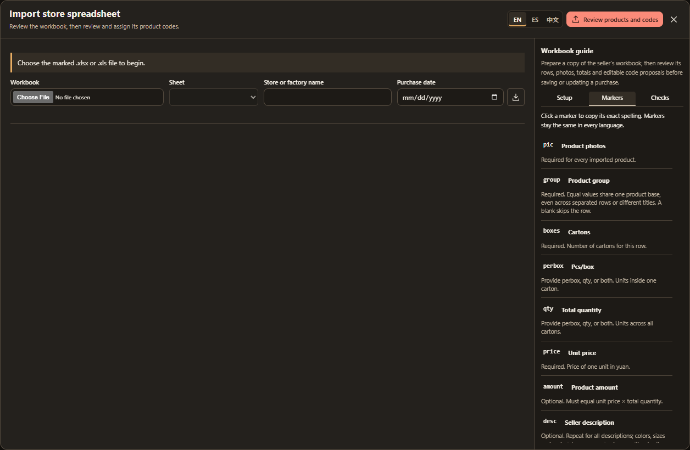

# 1688toPL

Turn 1688 purchases and supplier spreadsheets into packing lists, product barcodes and carton marks. Keep orders and photos in your browser, edit them in Orders and load named containers in Packing, then copy into Excel or download an editable workbook.

<a href="screenshots/order-library-dark.png"></a>

## Install or update

Install **Node.js 24**, then run these commands in the repository folder:

```powershell
npm ci
npx playwright install --no-shell chromium
npm run verify
```

In your Chromium browser, open **Extensions → Developer mode → Load unpacked** and select **dist**. After updating, reload the same extension and refresh open 1688 tabs. Keep the same installed folder and extension ID to retain your library. Existing owner installations use the [local development workflow](docs/development.md#local-development).

## 1. Add your orders

Click the **1688toPL** extension icon to open the workspace, then choose a source:

- **1688:** open your [orders](https://work.1688.com/home/buyer.htm), tick the purchases, choose **Import selected** and confirm the count. Keep the list open. If sign-in or verification is needed, choose **Open the 1688 tab**, finish it yourself, then **Resume import**.
- **Supplier workbook:** choose **Import spreadsheet**, download the template or [mark your workbook](docs/store-spreadsheets.md), then review its date, photos, quantities and total. Choose **Review products and codes**, edit details for the order, group or variant and check each group's base and endings, then **Import and assign codes** to save everything together. Nonblank `var` declarations control the suggested endings; descriptions retain physical sizes. Choose **Update existing purchase** to replace an earlier purchase from the same store after reviewing the changes; **Create new purchase** keeps deliberate repeat purchases separate. The update preserves matched codes and custom details, replaces imported rows and unsealed carton facts, and highlights unit-price changes separately from quantity changes.
- **Other purchases:** choose **Add order**, enter the supplier, reference, date and products, then **Save order**. You can also [import an order JSON file](docs/automation.md#orders-from-other-sources).

[Importing and finding orders](docs/importing.md) explains filtering, refresh and recovery.

<a href="screenshots/store-spreadsheet-import.png"></a>

## 2. Prepare products and cartons in Orders

Click a product to inspect its original source. Use its checkbox for selection. **Products**, **Cartons** and **Backlog** share the same order context; All Orders retains purchase history.

- Select product rows, then choose **Prepare products...**. Review their proposed barcodes, Spanish names, Chinese categories and materials together, then use **Confirm preparation** once. Products with the same 1688 source title form a family within that purchase; colours, styles and reliable size alternatives determine the endings. When sizes cannot be mapped reliably, distinct options receive letters while their source measurements remain visible. The complete order provides context, while only selected products change. Edit order, group or variant details in the same review. Existing codes and custom details remain intact, new codes use the original purchase month, and opening or cancelling reserves nothing. **Back** returns to your selection.
- **Edit product** opens naming, material, code and label controls in Orders. Photos/tags, supplier operations, WeChat and source financial details remain here.
- For a 1688 purchase, **Paste or import carton list** adds a supplier report to that existing order, with one scoped review and retained original source.
- **Reconcile cartons** opens one order table. Enter or paste Pcs/box, preview keyed/visible-row alignment, fill a range and use Tab/Enter. Derived quantities stay read-only. Capacity edits propose cartons; **Confirm order cartons** records the arrangement once for the order.
- Remainder actions prefill the actual unassigned pieces. For `100 at 45`, the table proposes two cartons and retains 10; choose a separate box or a same-order destination.

[Cartons](docs/cartons.md) explains exact facts, aggregate evidence, unknowns and draft recovery. [Packing and codes](docs/packing.md) explains product ownership and code review.

Deleting an order also retires its owned cartons and removes it from unsealed Packing containers after one review. Sealed shipment dependencies block deletion and show the container names. Containers and other orders remain; see [backup and deletion rules](docs/data-and-backups.md).

## 3. Load a container, then copy, export or print

Open **Packing**, create or choose a named container, and include whole orders from current Backlog. Inclusion reserves eligible remainder and starts cartons **Unconfirmed**. Use **Mark all loaded**, then choose the actual boxes left behind. Loading derives product quantities; it requires no repeated product-quantity entry.

**Review & seal** checks the complete container. Packing list and **Se quedó** are read-only revision views. **Edit in Orders** retains a return route; source/carton changes require reviewed availability or amendment. Backlog is the current global remainder, while Se quedó preserves that container's historical result.

- **Excel...** previews selected products with your chosen columns and details. **Copy image** copies the current table picture; **Export Excel (.xlsx)** downloads every selected product in one editable sheet with photos and carton marks. Linked carton dimensions and weights show actual saved evidence; identical measurements collapse and different sets remain clearly separated. **Copy…** keeps the other values, photos, columns and label formats.
- **Export packing list** captures the complete loaded revision, regardless of selected/filtered display rows. Default sheets are **Packing list**, **Cartons** and **Se quedó**. Advanced columns/layout remain optional. **Include detailed automation JSON** starts off for each export and discloses full costs, reasons and source identifiers independently of workbook columns.
- **Print…** produces label or carton-mark PDFs. Packing reprints revision data; label editing belongs in Orders. Print at **100% / Actual size** and calibrate before relying on physical dimensions.

Read [exports](docs/exports.md), [printing](docs/printing.md), [agent controls](docs/automation.md) or [keyboard shortcuts](docs/keyboard-shortcuts.md).

## 4. Back up your work

Use **Settings → Data → Back up** for the complete library as a lossless **`.json.gz`** archive. Restore accepts archives and older `.json` backups. **Restore packing** continues to accept historical scoped packing archives without reopening the retired preparation screen.

Keep a full backup before moving computers, uninstalling or clearing the browser profile. Use one buyer account per library. [Backup and restore](docs/data-and-backups.md) explains scope, photos, merge rules and recovery.

Orders, local rules and label generation stay on your device. Importing uses your signed-in 1688 session; uncached product photos may load from Alibaba CDN. There is no online translation or developer upload.

[All documentation](docs/README.md) · [Settings and photos](docs/settings-and-photos.md) · [Store operations and costs](docs/operations.md) · [Development](docs/development.md)
