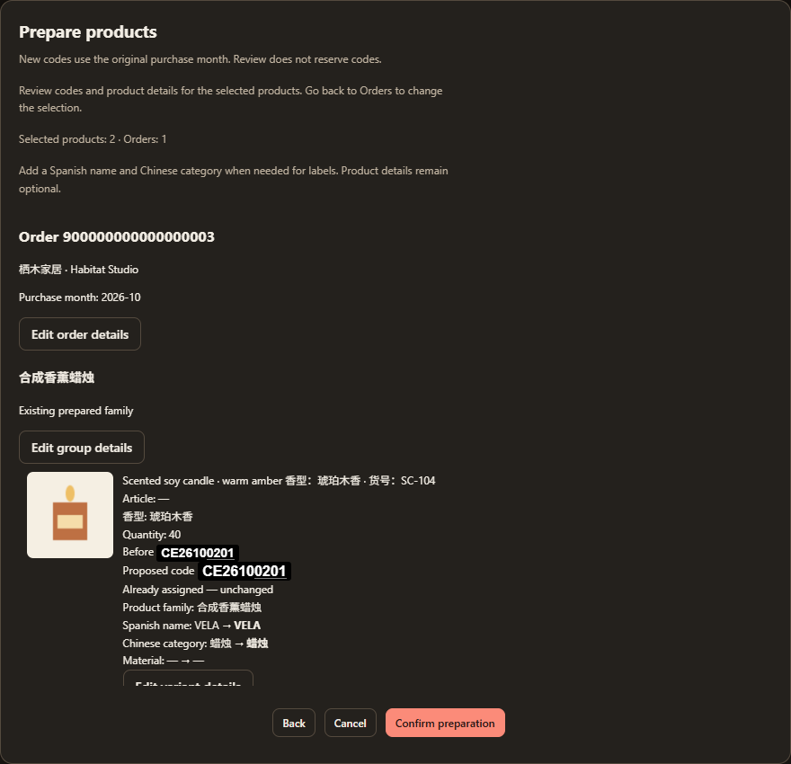

# Packing lists and codes

[Documentation](README.md) · [Cartons](cartons.md) · [Exports](exports.md)

## Assign products

Orders owns product/code/label preparation. Select product rows and choose **Prepare products...**. The review lists exactly those products by purchase and product family, with photos, articles, source attributes, quantities, purchase months and before/after barcodes, Spanish names, Chinese categories and materials. **New assignment** and **Already assigned—unchanged** distinguish code changes. Use **Confirm preparation** once for the complete selection. New `CEYYMMGGII` codes use each original purchase calendar month, independently of import or container date. Missing or ambiguous dates and supplier identities require resolution.

Select products in Orders, including across purchases; the confirmation has no selection controls. **Back** returns to that selection and **Cancel** saves nothing. An empty product selection cannot open the review. Validation must finish and every selected product must have a resolved full barcode before confirmation. Source, revision or ownership changes reject the complete assignment and retain the review for a new explicit confirmation; submission never silently substitutes codes. Opening or cancelling reserves nothing and changes neither source data nor cartons.

If a selected size is unresolved, **Resolve size endings** opens an unsaved review. Enter an ending or explicitly choose **Do not add size endings**, then apply to validate the full proposal. Invalid or duplicate barcodes retain the size draft for correction. Closing that review saves nothing; the final **Confirm preparation** remains separate. Existing shared identities require their affected source rows to be selected before changing their unresolved size, so a size decision never changes an unselected assigned identity.

Automatic suggestions inspect each complete source order before projecting onto selected rows. Product families are established before endings: matching articles or a supported alphanumeric model family provide evidence; repeated marketing titles alone do not. **Review product families** resolves uncertain cohorts as one family or separate products without changing source rows. A standalone product gets a bare base; styles use A/B/C, genuine size alternatives use size endings, and combined styles/sizes use their actual combinations. “如图所示” does not establish a size difference. Selecting only colour B in an A/B/C family still proposes B; later siblings reuse its existing base. Equal explicit spreadsheet groups and declarations retain their normal meaning. Identical identities may share a barcode while quantities and prices stay separate. Existing authored grouping, code edits and shared identities take precedence; saved products are never silently regrouped or recoded.

Use **Edit order details**, **Edit group details** or **Edit variant details** inside the review to author selected product details before saving. Suggestions come from local rules; manual exceptions and intentional blanks survive by default. Changes that would affect unchecked members of an existing shared identity require returning to Orders and selecting the affected rows. Family, size and detail choices remain in the review through allocation retries; changed source/preparation evidence requires a fresh review. Back and Cancel save nothing.

New product numbers are allocated only for selected new groups, in purchase-date, account/order and original source-group order, independently of click order or table sorting. Orders from the same supplier in the same account/month continue available numbering; other suppliers or months have their own allocation. Unselected groups reserve no numbers. Separate purchases retain separate identities unless explicitly linked.

Opening an unprepared product reviews the current selected rows when the clicked product is selected; otherwise it reviews only that product. There is no full-library code action or automatic expansion to unselected products.

Existing issued codes remain stable. A repeat link may reuse an eligible unconsumed identity from the same identified account/store with matching variants. Source prices, quantities, purchase references and physical carton IDs remain separate. A positive sealed loading freezes the consumed lineage against new links and unrelated code reuse, including after amendments. Selecting/reserving an order or a zero-loaded seal does not consume it.

Preparing selected products in Orders does not include them in a shipment. Packing includes whole orders and has no shipment-month code input. Leaving goods out of a container never removes them from Backlog. Only reviewed non-goods/fee/payment/canceled dispositions affect eligible stock; linked-payment evidence remains separate from source money.

## Edit and review

Click a product for source details; checkboxes select. **Edit product** opens contextual Orders fields for Spanish name, Chinese category, material and base/variant/size codes. Source descriptions, purchase quantities/prices and discounts remain read-only evidence. Photos, tags, supplier workflow, WeChat and financial additions are edited in Orders.

**Edit order details** applies selected fields across one purchase. **Edit group details** covers one CE product base, and **Edit variant details** changes its Spanish name or material. Chinese category stays shared by the group for carton marks. Bulk editing keeps manual exceptions, including intentional blanks, by default; **Replace all values** replaces them explicitly. The review shows affected counts and mixed materials. Several source rows sharing one variant also share its Spanish barcode-label name, without combining purchase values. Apply uses the existing revision checks and one Undo/Redo step; a failure retains the draft.

For spreadsheet purchases, a nonblank `var` defines the whole suggested ending. `a` produces `A`, even if the description also contains a physical size. Blank declarations retain normal size suggestions. **Do not add size endings** removes coding suffixes without claiming physical sizes are equal; its reviewed before/after codes preserve the base, variant letters and source facts. Existing purchases are never recoded on load, refresh or restore. See the [spreadsheet guide](store-spreadsheets.md#variants-and-descriptions).

The existing label editor retains preview validation, physical label settings and exact copying. Variant letters and size endings remain separate. Invalid/conflicting values keep the draft, revoke invalid preview output and require correction. **Resolve code conflict** reviews all affected final codes and saves them together after revision/ownership checks; failed corrections save neither order. Manual blanks remain intentional.

Valid authoring edits autosave; later typing survives an earlier acknowledgement. Pending edits flush before navigation/output. Failed raw authoring drafts remain recoverable in this browser with their source revision. Undo/Redo is scoped to the current Orders session; carton-grid history additionally survives draft recovery. Another tab's changes require revision review rather than silent replacement.

Background refresh preserves the revision, source clock and amendment epoch captured by product history. Undo/Redo rejects a changed owner, including after closing the form. Starting a new edit from the newly saved version clears stale history for that order; other orders retain their independent history.

## Organize and group

**Grouping tools** belongs to Orders. It can share a barcode within a group, separate original source rows, move variants into a product group or merge eligible complete groups in one order. Review preserves individual financial/source rows and all physical evidence; guarded storage rejects incompatible or historically sealed changes. Repeat links use their own reviewed eligibility checks.

Packing has no Organize, manifest drag order, product removal, capacity/code/photo/tag editor or grouping shortcut. Output uses stable source/prepared-code order. View filters and selection are display state, never shipment membership.

Copy and label controls capture their current **Packing list** or **Se quedó** side. Explicit partial mark output follows the selected products' retained physical references. The popup shows the captured row count and a shared **Headers** preference. Workbook export always retains the complete container revision and all three sheets.

## Containers and loading

Packing contains named container history and **Loading / Packing list / Se quedó**. Include whole orders from current Backlog. Previously shipped orders contribute only their eligible remainder. Inclusion reserves current evidence without loading any box; later purchases/cartons require **Review availability changes** and explicit apply.

Loading uses actual stable carton references and Unconfirmed / Loaded / Left behind decisions. **Mark all loaded** covers the full included logical scope, including offscreen/filtered rows. A count shortcut appears only when the authoritative projection permits interchangeable boxes. Uneven contents or different measured boxes require their identities. Product loads derive from these decisions: loading A20+B72 loads 92 pieces across both products.

Review & seal checks complete decisions, revisions, known loaded quantities and exclusivity. Missing kg/CBM is disclosed; unknown loaded product quantities or contradictions cannot verified-seal. Complete aggregate product coverage may support full loading without inventing per-box variants. Numerical equality alone does not establish coverage.

Se quedó freezes remaining goods from this container's included orders at the selected revision. Global Backlog also includes untouched and new purchases. **Amend sealed container** keeps the previous effective revision active until reviewed atomic apply; Cancel changes no shipment. Historical names, prices, codes, photos and Se quedó remain reproducible.

## Code ownership and conflicts

`CEYYMMGGII` contains purchase year/month, monthly seller group and product number. Shared identities retain separate source rows. Display underlines only product-number digits; copied strings remain literal. Current assignments and consumed historical lineage are validated at commit. Checkpoints do not reserve retired unconsumed assignments, and historical consumed codes cannot be recycled for unrelated goods.

Packing details and photos are read-only. **Edit in Orders** retains the exact container/revision return target. Returning does not silently add new cartons or rewrite a sealed manifest; relevant facts need reviewed revalidation or amendment.
