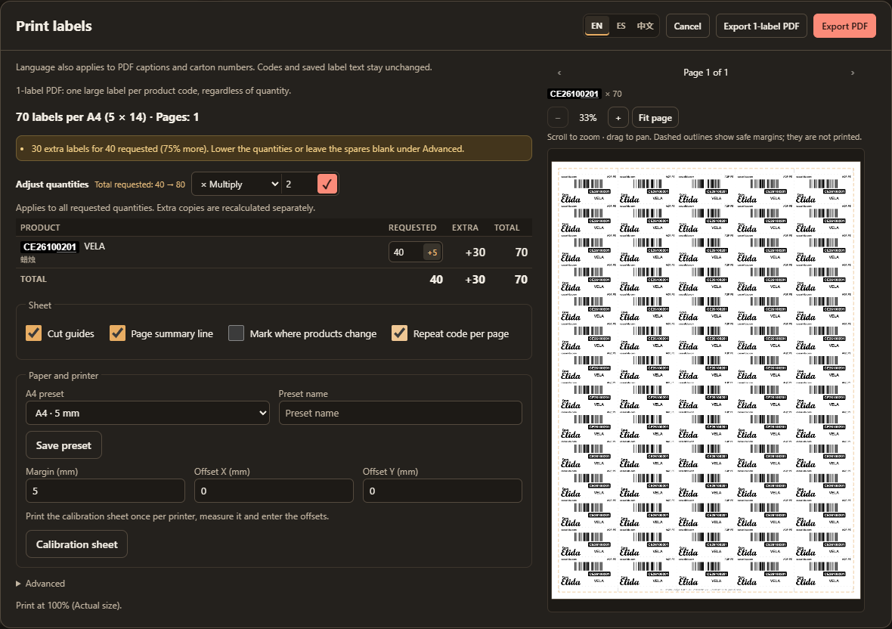
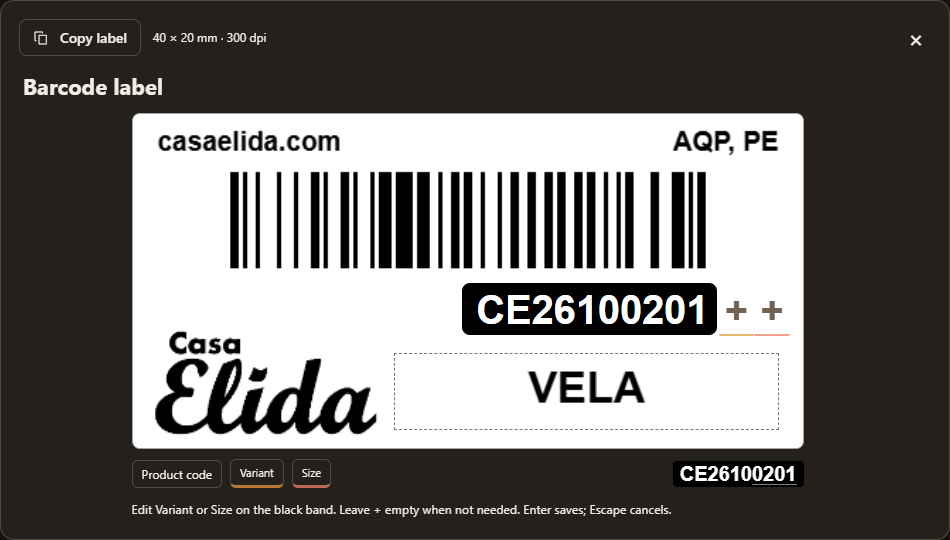

# Printing labels and carton marks

[Documentation](README.md) · [Cartons](cartons.md) · [Export files](automation.md#export-files)

Select prepared products, then **Print… → Print labels…** or **Print carton marks…** in Orders or Packing. The quantity table shows requested, extra and final counts. Order labels need saved preparation for every product in scope. Shared repeat-purchase barcodes combine selected quantities while retaining purchase references.

## Quantities and layout

The small **+5** inside label quantity fields adds five; carton marks use **+1**. Values remain within 0–9999. **Adjust quantities** applies Multiply/Divide with a whole factor 1–9999. Review the before/after requested total, then use **✓ Apply to all** or Enter in Factor. Division rounds each product upward and preserves zero. Invalid/overflowing results identify the product and apply nothing. Source quantities and physical carton records stay unchanged.

Label artwork comes from **Settings → Labels**: defaults are 40 × 20 mm barcodes and 148.5 × 105 mm carton marks, rendered at 300 DPI. The barcode default fits 70 per A4 at 5 mm margins and turns 90° only when that fits more. Requested labels always print, keeping products together in selected order. Spare places on the last page are shared proportionally: requests of 40 and 50 in 100 spaces become 44 and 56. A warning identifies extras above 25%. **Advanced** can share equally, leave spares blank, cap extras per product or add gaps. Guides and product-change marks do not cover barcode/text.

Carton marks occupy two A4 halves with a middle cut guide. Artwork scales proportionally into each half, leaving room for enabled numbering/page summaries. Turning annotations off returns that space to artwork. Exact capacities or complete physical records initialize mark counts. Leftovers, partial coverage or missing capacities require your actual count and **Reviewed** acknowledgment; changing the count clears review. When every capacity is unknown, one remains an explicitly manual starting count. **Carton n of N** and an extra copy for an odd final half are optional. Print counts never alter physical contents or receipt/loading confirmations.

## Preview and download

Enable **Repeat code per page** under **Sheet** to keep each product code on its own A4 sheets. A product needing more than one sheet continues on subsequent pages; the next product always starts a fresh page. Spare places are filled with that same code according to **Advanced**, including blank spaces and extra-copy caps. This setting updates the preview and **Export PDF** and is remembered for later label jobs.

Margins, offsets, guides, numbering and advanced layout update while editing. Dashed safe areas are preview aids and never print. Small margin changes may retain the same centered grid until fewer labels fit. While artwork updates, the last complete preview remains visible.

Review every page with Previous/Next. Scroll around the pointer to zoom, drag to pan, or use **− / + / Fit page**. Focused preview arrows pan, **+/−** zoom and **0** fits. Preview zoom does not change PDF dimensions.

**Export PDF** downloads locally with a companion JSON summary. Popup **EN / ES / 中文** controls captions, numbering, calibration instructions and filename prefixes while preserving codes, source wording and authored label names. English names resemble `CE-labels-2026-10-23-153012-3-products.pdf`; JSON uses the same stem. PDF image resources are reused without repeating the complete image table per page.

Print at **100% / Actual size**. Barcode bars use Code 128 with quiet zones; overly dense codes or text that cannot fit report an error. Hardware scanner use and physical printing require their own acceptance checks.

**Export 1-label PDF** downloads one large label per distinct product code. Each PDF page fits the label exactly, preserving its proportions without surrounding A4 whitespace or added margins. The default 40 × 20 mm design exports as a 200 × 100 mm page; custom proportions retain the enlarged scale within 200 × 287 mm. The label's own internal spacing and barcode quiet zones remain intact. It includes every printable code in the dialog, including rows with zero requested quantity. Quantities, spare labels, offsets, cut guides and other sheet settings do not apply. Artwork is rendered afresh at 300 DPI at the enlarged size; the PDF contains no sheet annotations. The filename ends in `-1-label.pdf`, with a matching JSON summary showing one label per page. Recent jobs identify this format; use **Export 1-label PDF** again when regenerating it. The on-screen preview continues to show the standard sheet output.

## Calibrate and reprint

**Calibration sheet** produces 10 mm/100 mm rulers in both axes and two crosses, without a JSON summary. Measure them, enter **Offset X/Y** from −5 to +5 mm, and save margins/offsets as a named A4 preset. Labels and marks keep separate settings. A warning appears when content approaches within 4 mm of the paper edge.

**Print… → Recent print jobs…** retains the five latest exports, including output language and carton references. Print the saved PDF for an exact reprint. **Regenerate** uses current product data with saved quantities/settings and warns that data may have changed.
