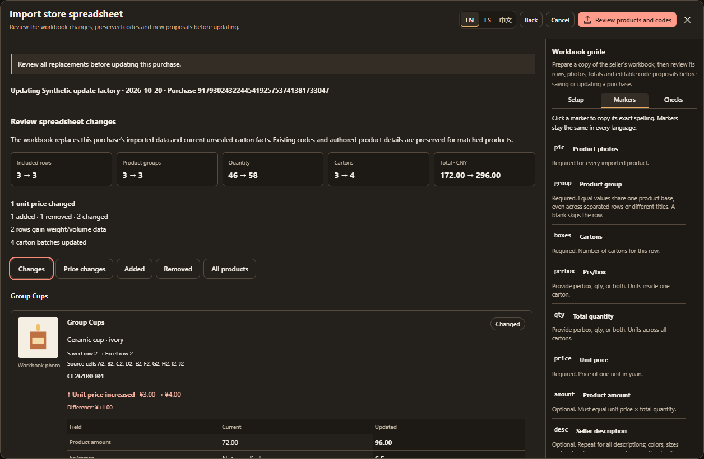
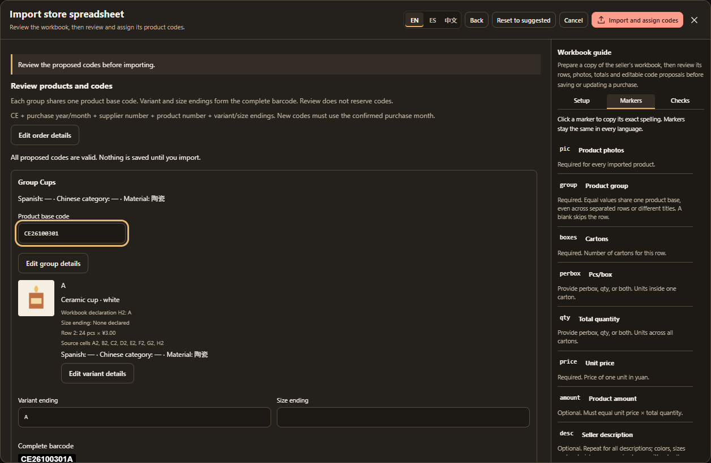
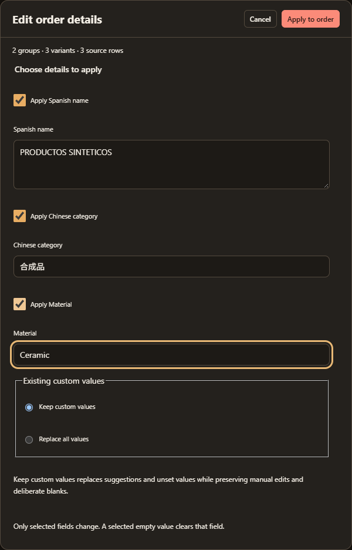

# Store spreadsheets and import markers

[Documentation](README.md) · [Importing](importing.md)

## Prepare the workbook

Choose **Import spreadsheet** for a marked `.xlsx` or genuine Excel `.xls` workbook. A numeric filename such as `12345.xlsx` identifies a market store; a company-name filename identifies a factory. Windows copy suffixes preserve store identity. Confirm the purchase date and display name during review. You can edit the display name later without changing the underlying store identity.

Choose **Create new purchase** for a separate purchase. When the filename identifies a store already in the current account, **Update existing purchase** lets you replace one saved spreadsheet purchase instead. A single matching purchase is shown with its date, total and product count; choose the target explicitly when several exist. Store names alone never combine purchases. Familiar Windows copy suffixes preserve store identity; an archival suffix such as `_antiguo` does not identify the original numeric store.

Use **Download template** beside Purchase date for a blank **Orders / Guide** workbook. It includes markers, 20 photo-ready rows, frozen headings, numeric formats and quantity/amount formulas. Save a completed copy under the store number or factory name, embed photos in each product's photo cell, recalculate/save in Excel or WPS, then select **Orders** when importing. Enter the supplier's invoice total independently of the calculated comparison. For a manually supplied total quantity, replace that row's quantity formula and leave Pcs/box blank.

To adapt a seller workbook, add one marker row above its headers. Read only the columns you mark; unmarked columns are ignored. Column order is flexible. Only `desc` may repeat. Leave `group` blank on notes, totals and unused product rows to skip them.

## Marker reference

Markers ignore case and surrounding whitespace. Use these exact English spellings; pinyin names and alternatives such as `variants` or `totalp` are not aliases.

| Marker                 | Required                | Meaning                                                                                               |
| ---------------------- | ----------------------- | ----------------------------------------------------------------------------------------------------- |
| `pic`                  | Yes                     | Embedded product pictures; multiple pictures are retained.                                            |
| `desc`                 | No                      | Description fragment; repeat across columns to retain all useful text.                                |
| `boxes`                | Yes                     | Positive whole carton count for the source row.                                                       |
| `perbox`               | One of `perbox` / `qty` | Whole pieces per carton.                                                                              |
| `qty`                  | One of `perbox` / `qty` | Positive whole total pieces.                                                                          |
| `price`                | Yes                     | Nonnegative unit price in yuan.                                                                       |
| `amount`               | No                      | Source-row amount, checked against price × quantity.                                                  |
| `group`                | Yes                     | Source product-group identity; blank skips the row.                                                   |
| `var`                  | No                      | Explicit variant/size declaration.                                                                    |
| `kg`                   | No                      | Kilograms per carton.                                                                                 |
| `cbm`                  | No                      | Supplied cubic metres per carton.                                                                     |
| `cbmx`, `cbmy`, `cbmz` | No                      | Complete length, width and height in centimetres. Calculated volume takes priority over supplied CBM. |
| `total`                | Exactly two             | Surround the independent invoice amount in one row or column: `total` · amount · `total`.             |

When both capacity and total quantity are present, `boxes × perbox` must equal `qty`. With quantity alone, a capacity is derived only when division by boxes is an exact whole number. Ordinary unit text such as `6元`, `8RMB`, `20.5 K.G.` and `0.14 CBM` is accepted. Multiple numbers, calculations and dimensions stuffed into one numeric cell are ambiguous and rejected. Workbook decimals use a point; commas are thousands separators.

## Review before saving

The **Setup / Markers / Checks** sidebar supplies the same copyable guide available in **Settings → Data → Store spreadsheet guide**. It scrolls independently from review and stacks below it on narrow screens.

Review cards identify source cells, groups, photos and arithmetic. **Check all** acknowledges eligible review items only. It does not resolve quantity allocations, missing pictures, financial errors, an unconfirmed date or final photo/total confirmation.

After these checks, choose **Review products and codes**. This opens editable product details and code proposals without saving the order, photos or preparation and without reserving codes. Review one shared base per product group and the variant and size endings beneath it, then choose **Import and assign codes**. The final action saves the order, original photos, authored details, preparation, reviewed assignments and source carton facts together in one transaction. A failed validation saves none of them. Closing during parsing cancels the reader; saving locks dismissal.

Financial and quantity mismatches block import. Formula cells need saved results without Excel errors; the importer never runs formulas or macros. Recalculate and save the workbook when those results are absent.

Every included row needs a readable linked picture. A picture whose anchor or merged `pic` cell covers several included rows can serve all covered groups after explicit shared-photo review. Blank groups stay skipped. Picture proximity or another row's group does not fill an uncovered row. Shared originals are retained once, while gallery associations remain separate.

## Update a saved purchase

Use the store number or factory name as the filename, choose the matching purchase and complete the normal workbook checks. The saved source is the comparison baseline; uploading the old workbook is unnecessary. Updates retain the purchase ID and original purchase date.

**Review changes** shows current → updated product, piece, carton and amount totals. Cards group products by Excel `group`, with existing codes, photos, descriptions, declarations and source cells. **Changes**, **Price changes**, **Added**, **Removed** and **All products** filter the view only; the operation replaces the complete reviewed purchase. A changed subtotal caused by quantity is distinct from an increased/decreased unit price. Unchanged unit prices are stated explicitly, while new products show a new price rather than a price increase.

The new workbook is authoritative for all supported imported values: missing rows are removed, new rows are added, and blank optional measurements become unknown. Excel also replaces current unsealed carton counts, capacities, dimensions, weight and volume, including manual facts. Matched products retain their entry/group/variant/carton identities, CE codes and authored names, categories, materials, intentional blanks, notes and tags. Changed photos remain visible in the comparison.

Rows are matched by supported product identity, not their Excel position. Reordered rows retain identities; ambiguous matches need an explicit existing-row or new-row choice. Changed grouping/declarations that conflict with assigned codes require a correction review. New variants can join the existing group base; only genuinely new groups need new bases.

Choose **Update purchase** after reviewing changes and product codes. Source/history, original photos, capacities, preparation, cartons and assignments save together; a failure saves none of them. Sealed shipment history, incompatible loading/reservations, payment links, exclusions, code ownership or a concurrent edit may block the operation and identify what needs resolution. Back retains the draft, Cancel saves nothing, and retrying a successful confirmation cannot create a duplicate purchase. An identical workbook reports **No changes to apply**.

## Review and edit codes

Equal `group` values share one product base, even when the rows are not adjacent or have different titles. Edit the base once to update the entire group. A workbook value such as `12` is only a grouping key; it does not request product digits `0012` or assign a CE code. Different group values remain separate products.

The code review shows the source group and its members, with editable base, variant and size fields and the resulting full barcodes. Check the live barcode after every edit. For example, rows labelled `tray` with variants `A` and `B` share a proposed base such as `CE26100101`; their full barcodes may be `CE26100101A` and `CE26100101B`. A different title on the second row does not split `tray` into two bases. This is an illustrative October 2026 purchase; actual available codes depend on the purchase, supplier and current library.

New bases must use the confirmed purchase calendar month and the known supplier identity. Current assignments and immutable shipment history protect ownership; editing a proposal uses the same validation as ordinary purchase-code assignment. Resolve invalid bases, duplicate or conflicting full barcodes and unknown inferred sizes before confirming. Keep variant endings and size endings separate. **Do not add size endings** removes the coding suffix while retaining physical size descriptions; products can have different physical sizes already identified by their variant letters.

### Edit shared details and exceptions

Use **Edit order details** for the whole purchase, **Edit group details** for one CE product base, or **Edit variant details** for an individual barcode identity. Order and group scopes offer Spanish name, Chinese category and Material; variant scope offers Spanish name and Material. Chinese category stays shared by the group for its carton mark, with **Edit group category** available from a variant.

Select only the fields to apply. **Keep custom values** is the bulk default: suggestions and unset values can change, while manually authored values and deliberate blanks survive. Choose **Replace all values** explicitly to replace those exceptions. Review the affected counts before Apply; Cancel changes nothing. Mixed materials and custom exceptions remain visible. A Spanish-name edit for a variant shared by several source rows affects their common barcode label, while their quantities and prices remain separate.

These controls are also available in Orders after import. During import they edit only the unsaved draft; Back retains the edits and resetting code suggestions preserves product details. Blank details do not block import, but labels still need their required names or category. Source descriptions, photos and financial evidence remain unchanged.

Use **Back** to return to workbook review or **Cancel** to leave without saving. **Reset to suggested** restores the suggested code proposals. None of these draft actions reserves codes. Final confirmation revalidates against the current library, including codes assigned since the proposal was opened. Resolve any new conflict and review again before the import can save.

## Variants and descriptions

Equal `group` values collect source rows even when not adjacent; they are not CE codes. A nonblank `var` declares the complete suggested barcode ending: `a` means `A` with no added size ending, `s` means size `S`, and `as` means variant `A` plus size `S`. Measurements in descriptions do not add another suffix to a declared ending. The review identifies the workbook declaration and source cell beside the editable endings and complete barcode; deliberate edits remain custom choices, and resetting suggestions returns to the declaration.

A row marked `abcd` declares A/B/C/D sharing one source quantity, amount and carton record. Supply actual positive per-variant quantities during review, summing to the source quantity and preserving its rounded total. Do not divide equally by assumption or use picture count as a split. `abs`, `abm`, `abl` mean A/B in S/M/L; ambiguous nested or repeated assortments are refused. Repeated identical explicit identities may share a barcode while their source rows remain separately accounted.

The reviewed split does not duplicate source cartons. Printing only part of a shared carton record needs explicit carton-count review. Physical contents are recorded separately in [Cartons](cartons.md).

All marked `desc` text is joined with `·` and retained. Seller headers help recognize article/model IDs, Color, Size and Material. Leading zeroes in article codes remain. When `var` is blank, clear measurements such as `25cm` or `8.5"` feed size suggestions even without seller headers. Incompatible measurements stay for review and unitless values stay unitless. When `var` is declared, physical sizes remain visible without being appended automatically; description-based size suggestions require an explicit reviewed action. Loading, source refresh and backup restore do not automatically recode older purchases.

To correct an existing purchase with unwanted inferred size endings, use its group size-handling review in Orders. Check all before/after barcodes, retain the existing base and variant letters, and apply **Do not add size endings**. The transaction rechecks current codes, revisions, physical marks and shipment history. Do not delete and reimport the purchase to repair its codes: another import creates a separate order with newly allocated bases.

Spreadsheet orders use the same packing, labels, costs and backup features as 1688 orders. They retain their source descriptions and original photos, have no fabricated 1688 links, and are excluded from 1688 refresh. See [photo editing](settings-and-photos.md#product-photos) and the [developer contract](development.md#china-store-spreadsheets) for persistence and template details.

After import, the reviewed codes are already assigned. Use **Orders → Products / Cartons** for later corrections and physical facts. Original photos, descriptions, purchase prices, quantities and totals remain source evidence. Supported carton facts from the workbook are retained once; capacity edits alone do not create more cartons. Confirm any remaining physical decisions at order level, then include whole orders in a named **Packing** container and review Loading before sealing. Shared codes never combine physical cartons from different purchases. Historical loaded counts stay review evidence until resolved; they do not create verified shipments.
